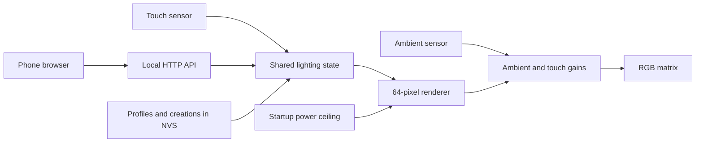

# System architecture

The ESP32-S3 hosts an offline HTML/JavaScript interface and local HTTP API.
The phone controls the device directly over its setup access point or the home
LAN. There is no cloud backend, remote-control service, child account or audio
pipeline. Internet access is currently unused by animations.

## Firmware responsibilities

| File | Responsibility |
| --- | --- |
| `DragonPrototype.ino` | Startup, shared lighting state, renderer, touch and serial control |
| `DragonCore.h` | Logical layout, wiring transforms, RGB and current-estimate primitives |
| `SensorControl.h` | Ambient thresholds, hysteresis and touch gestures |
| `StartupPower.h`, `PowerPolicy.h` | Startup sweep, diagnostic records and output limiting |
| `ConnectionPolicy.h` | Setup gesture, retry/inactivity timing, per-device name suffix |
| `DragonLibrary.h` | Profile membership, creations, checksummed alternating snapshots |
| `DragonWeb.h` | Authentication, Wi-Fi, captive DNS, state and play API |
| `LibraryWeb.h` | Profile and creation API validation |
| `DragonPresets.h` | Generated catalog; edit `presets/dragons.json` instead |
| `DragonWebPage.h` | Generated embedded page; edit `web/` instead |
| `build_opt.h` | Enables network event callback locking across the build |

## Persistent state

| NVS namespace | Contents |
| --- | --- |
| `dragon-wifi` | Unique setup password and last successfully joined home network |
| `dragon-library` | Active profile, saved glow, favourites, custom region overrides/effects |
| `dragon-light` | Explicit ambient calibration |
| `dragon-diag` | Four retained failed startup sweeps |

Library snapshots contain version, generation and checksum fields. A verified
alternate snapshot is written before live RAM changes. Startup chooses the
newest valid snapshot, with fallback to the previous one. Profile zero is
normalised to protected All when loading or saving. Record layout/catalog-order
changes require a migration; neither is currently a portable export format.

Custom records reference a supplied base dragon and store region colour masks,
colours and region-effect masks, preserving untouched base pixels. Profile
deletion transfers creations to All. A creation can be shared as a favourite;
editing/deleting it requires its owner profile, while other profiles can copy.

## Wi-Fi lifecycle

- No saved network: open the password-protected setup AP.
- Saved network: try joining it; do not open the AP automatically after failure.
- Deliberate power-on touch hold: reopen setup without deleting credentials.
- Connection timeout: 20 seconds; saved-network retry: one minute.
- Configured AP with no joined clients or active connection attempt: close
  after five minutes of inactivity. An unconfigured AP stays available.
- Commit home-network credentials only after association succeeds. This does
  not check internet reachability.

Local HTTP uses browser authentication (`parent` and the setup password).
Mutation requests require `X-Dragon-Request: 1`; ordinary cross-site forms are
rejected. HTTP is not encrypted on the home LAN. There is no port-forwarding,
remote-control or OTA endpoint in this version.

## HTTP API

All routes below require authentication. POST routes also require the custom
request header. Mutation bodies use form-urlencoded fields, not JSON.

| Method / route | Purpose |
| --- | --- |
| GET `/` | Embedded phone page |
| GET `/api/state` | Connection, selected profile/dragon, effect and brightness |
| GET `/api/dragons` | Active profile's play collection |
| GET `/api/dragons?catalog=1` | Complete catalog for editing/favourite selection |
| POST / GET `/api/scan` | Start asynchronous Wi-Fi scan / inspect results |
| POST `/api/wifi` | Join candidate `ssid` and `password` |
| POST `/api/forget-wifi` | Reopen setup and forget home Wi-Fi |
| GET `/api/library` | Profiles, active ID and creation capacity |
| POST `/api/profile` | `create`, `update` or `select` profile |
| POST `/api/delete-profile` | Delete nonzero profile, retaining creations in All |
| GET `/api/dragon-detail?id=...` | Pixel/region editor data and ownership flag |
| POST `/api/custom` | Create or replace a validated custom dragon |
| POST `/api/delete-custom` | Delete an owned creation and remove favourite references |
| POST `/api/play` | `dragon`, `effect`, `brightness` or `toggle` action |

## Power and rendering

Networking starts after a passing startup power selection. Computer USB caps
the session at an estimated 400 mA. Wi-Fi reserves a further provisional 50 mA
from the LED budget. Every animation uses channel/current limiting before
ambient and touch percentages. This allowance needs measurement on the actual
supply; voltage plus a model is not an actual-current measurement.

Supply ADC sampling stops after startup. Current-run statistics and session
ceiling are RAM-only. Successful boots keep earlier failure history. The
hardware and startup guide contain the precise criteria and limitations.
